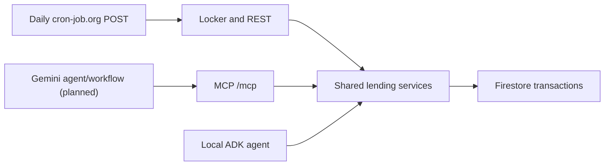

# Development

Use [Build stages](BUILD_STAGES.md) for progress, [Demo guide](DEMO_GUIDE.md) for
presentation, and [Operations](OPERATIONS.md) for hosted configuration.

## Architecture



Gemini supplies the planned chat/workflow interface. FastAPI and FastMCP are two
entrypoints to the same Python domain services, not two separate backends.
Firestore is the source of truth so booking and locker changes share transaction
checks. The server-rendered locker is a virtual device, not physical hardware.

| Code | Responsibility |
| --- | --- |
| `domain/reservations.py` | Request validation, Malaysia time, shared eligibility and capability rules |
| `domain/scenarios.py` | Fictional fixtures |
| `reservations.py`, `pickups.py`, `returns.py` | Lending transactions |
| `recovery.py`, `reassignment.py` | Detect conflicts, propose, recheck, and apply substitutes |
| `storage/local_state.py` | One Firestore state document and transaction helper |
| `storage/collection_state.py`, `emulator_collections.py` | Emulator-only collection layout and review app; hosted storage stays unchanged |
| `api/app.py`, `api/auth.py`, `templates/`, `static/` | Login, shared account checks, role-protected REST, and locker views |
| `agent/reservations.py` | Existing ADK booking tools and instructions |
| `code_email.py` | Optional Gmail API code delivery, claimed after lending transactions |
| `mcp_server.py` | Five tools, stdio or stateless Streamable HTTP |
| `vercel_demo.py`, `vercel_app.py`, root `main.py` | Hosted guards, MCP lifespan, and Vercel export |

## Data and implemented rules

State holds assets, reservations, offers, loans, compartments, pickup/return
access, recovery records, and audit events. Reservation, custody, compartment, and
condition are separate states. The store takes an explicit document ID; automated
tests use emulator-only test documents. See [Operations](OPERATIONS.md#data-boundaries)
before selecting any cloud profile.

### Collection layout review (emulator only)

The proposed layout puts records under `environments/development`. Each test uses
its own `environments/test-<random-id>` workspace. The environment document holds
the scenario, fixed clock, schema version, record-group list, and revision counter.
These are real collections under that document, rather than maps inside it:

| Collection | Records |
| --- | --- |
| `assets` | Equipment units and capabilities |
| `reservation_offers` | Offers awaiting borrower confirmation |
| `reservations` | Confirmed bookings and pickup state |
| `loans` | Equipment custody and return deadlines |
| `locations` | Loan desk details |
| `lockers` | Locker identity |
| `locker_compartments` | Compartment status and locker ID |
| `pickup_access` | Pickup codes, attempt counts, and unlock state |
| `return_access` | Return codes, drop-off state, and staff checks |
| `at_risk_reservations` | Bookings affected by overdue loans |
| `recovery_proposals` | Substitute proposals and approval state |
| `recovery_reminders` | Simulated reminder records |
| `recovery_escalations` | Cases needing staff follow-up |
| `audit_events` | Ordered action records |

Collection names use lowercase plural nouns and underscores. Existing meaningful
IDs, such as `projector-a` and `active-projector`, stay stable. Codes stay separate
from bookings and are still excluded from staff and model status results. Missing
optional groups have no documents until a workflow creates them.

The adapter reconstructs the existing domain state so the lending rules remain
shared. Changes update the environment revision and changed child documents in
one transaction. Reset removes obsolete child records in that environment only.
Every integration test runs against both the old and proposed layouts, including
the competing-process booking check.

This is a naming and storage review, not a scalability upgrade. Reads still load
the workspace, and changes serialize on its revision. Large inventories and long
audit histories need narrower queries and transactions before production use.
The adapter refuses to start without a loopback Firestore emulator. It cannot be
selected by the hosted entrypoint and does not migrate or delete cloud documents.

To inspect it, start the emulator in terminal 1:

```powershell
npx --yes firebase-tools@15.35.0 emulators:start --only firestore --project demo-campus-asset-concierge
```

In terminal 2, with your existing local account settings in `.env`:

```powershell
$env:FIRESTORE_EMULATOR_HOST = '127.0.0.1:8080'
uv run --env-file .env python -m campus_asset_concierge.seed_demo spare_available --layout collections
uv run dev-collections
```

Open `http://127.0.0.1:8001/login`. The login page lists the public borrower and
staff test passwords; the private account settings still sign browser sessions.
The seed is create-only and stops if `environments/development` already exists.
Use a deliberate operator reset in the review app only when you want to replace
that emulator workspace. Neither these commands nor the review app copy cloud data.

A fictional review export is available on the current development machine at
`.firebase/collections-review` (ignored by Git). Add
`--import .firebase/collections-review` to the emulator start command to reopen it,
and skip the seed command. The export already has the overdue recovery scenario.
Stop an existing dev server before installing the new console command on Windows.

Cloud migration remains a separate approval step. Before proposing it, compare an
emulator copy against the source, review auth/rules and queries, plan a create-only
destination and rollback, and update the hosted document/reset guards together.
Never overwrite or rename `demo/current` or `demo/hackathon-20261111` as part of
this emulator review.

### Booking and matching

- One category and one asset per booking; Malaysia-time pickup plus due time or duration.
- Reject past pickup, invalid windows, unknown fields, and malformed requirements.
- Offers do not reserve inventory. Confirmation rechecks stock, ownership, condition, loans, locker access, time overlap, and saved requirements in one transaction.
- Back-to-back booking windows are allowed. An on-schedule active loan may support a later booking; overdue/awaiting-check loans and condition holds block availability.
- The borrower gets the same reservation when retrying a successful confirmation. Exactly one competing confirmation can win the last unit.
- Projector flags `require_hdmi` and `require_built_in_speakers` are strict booleans. True requires an explicitly present capability; false/omitted means unrestricted, not forbidden.
- Kits cannot request projector-only capabilities. Old records missing flags remain category-only; never infer borrower needs from the assigned asset.
- Use the shared `eligible_unit()` rule for offers, confirmation, recovery, recheck, and approval. Select candidates in sorted asset-ID order.

### Pickup

| Action | Reservation | Compartment | Custody |
| --- | --- | --- | --- |
| Staff confirm loading | `ready_for_pickup` | `loaded` | Code issued |
| Borrower unlocks | Remains `ready_for_pickup` | `unlocked` | Code consumed |
| Borrower confirms pickup | `collected` | `empty` | One `active` loan created |

Loading needs an empty compartment and a good unit with no open loan, loaded
access, or earlier collectable booking. Confirmation must happen before the due
time. A deterministic loan ID prevents duplicate loans. Loaded stock cannot be
offered for a conflicting earlier window.

Codes are random six-digit values generated outside retryable transactions.
Pickup codes work from pickup until 30 minutes later. Reject early, expired,
wrong-owner, used, or blocked codes. Five wrong attempts block a code; save the
attempt before returning the error. A wrong-owner attempt does not consume tries.
Codes are separate from reservations and never appear in ADK/MCP status tools.
The current locker asks the borrower to enter a code but does not display it:
the borrower-owned `GET /pickups` supplies the demo stand-in until email is wired.
The borrower page labels this stand-in and links to `GET /pickups` and `GET /returns`.

The borrower UI groups real API states into pickup and return cards. Unassigned
compartments stay unassigned; open doors appear only after a successful unlock.
Six visual code cells share one labelled text input, so paste, leading zeros,
backspace, mobile keyboards, and screen readers use normal input behavior.
The server still checks ownership, time windows, attempts, and one-time use.
Borrower styles and code-entry behavior are separate from the staff workspace.

### Return and compartments

Return uses locker drop-off rather than a desk-only handoff to match the pickup
story. Pickup and return share six compartments (A1 to A6); when all are occupied, a
new allocation is rejected. Collecting an item frees its compartment.

| Action | Loan | Compartment |
| --- | --- | --- |
| Borrower requests return | Still `active` or `overdue` | `return_reserved` |
| Borrower enters return code | Unchanged | `unlocked` |
| Borrower confirms drop-off | `awaiting_check` | `returned` |
| Staff check: pass | `returned` | `empty`; asset remains good |
| Staff check: fail | `returned` | `empty`; asset placed on hold |

`return_access` is keyed by asset, linked to its open loan. This also supports the
seeded loan that has no reservation. Return codes work immediately for 30 minutes,
use the same attempt/ownership checks, and stay out of agent tools. Read the
borrower's code from `GET /returns` during the demo.

Repeated request, drop, and verification actions do not create duplicate records.
A live return or awaiting-check state blocks new offers even for later windows.
Expired, undropped returns release their compartment lazily on the next return
allocation, including unlocked-but-never-dropped returns. No hold-release/repair
flow is implemented.

### Recovery and reassignment

- Mark a loan overdue when due time is strictly before the demo clock.
- Inspect its next future confirmed booking; flag it at risk and queue a simulated reminder.
- Store reminders by `overdue-{loan_id}`, and at-risk records, proposals, and escalations by reservation ID.
- Propose an eligible alternative as `pending_staff_approval`; otherwise create an escalation owned by `equipment-staff`. Proposing leaves the booking unchanged.
- Staff approval requires the displayed `proposal_id`. A transaction revalidates the original booking, absence of pickup access, clock, substitute availability, and saved needs before moving the asset assignment.
- Approval preserves requirements, clears the at-risk flag, records the approver/audit event, and leaves the original loan overdue. Repeat approval of the same applied proposal is safe.
- Staff recheck retains an unchanged proposal without another event. Changed stock creates a fresh proposal ID, or replaces the pending proposal with an escalation.
- A stale proposal ID returns conflict; concurrent recheck/approval cannot silently apply an unreviewed substitute.
- Recovery is idempotent. It does not send email, approve proposals, advance time, or reset state.
- Each run saves `last_recovery_run`: real run time, test-clock time, and the number of new audit events. A rerun changes only this record.

Only the next booking is considered. Proposals do not hold inventory, so separate
pending proposals can compete for one spare; approval must revalidate. Global
allocation, reopening escalations, offer expiry/pruning, and bookings skipped by
large clock jumps are outside this prototype.

### Staff visibility

- The staff dashboard shows next to load, compartments, returns to check, overdue recovery, bookings, equipment use, and activity.
- The recovery panel shows when recovery last ran in real time, so staff can tell whether the daily job ran.
- Equipment use lists each unit's current state, loan count, time on loan, and upcoming bookings. Loan time runs from pickup to drop-off on the test clock.
- The Bookings page searches and filters bookings and offers loading and return checks.

Audit events record time, actor, action, and asset. Reservation IDs may be null
for returns. UI rendering must handle that and unknown action labels safely.
Codes are plaintext only because this is fictional data; real use needs stronger
credential storage and trusted identities.

## API and MCP contracts

Browser users sign in at `/login`, choosing borrower or staff and using their
existing username/password. A signed HttpOnly, SameSite=Strict cookie lasts eight
hours and is Secure over HTTPS. Roles always come from the account configuration;
choosing staff cannot turn a borrower into staff. `/logout` clears browser cookies.
The operator cannot sign in through this form. REST also retains HTTP Basic for
non-browser clients and operator tools. Use OpenAPI at `/docs` for full schemas.

Only the pinned hackathon entrypoint enables public judging passwords from
`DEMO_PASSWORDS`. The login page lists them and can fill the form. The standard
app rejects them. These public passwords also work with REST Basic for judging.
Private environment passwords still work and sign cookies; they are never rendered
into the page. The operator has no public password or account-selection button.

Cookie signatures use itsdangerous with SHA-256, a purpose-specific salt, and the
account's existing password secret, so no new deployment variable is needed.
Rotation invalidates that account's cookies; signatures work across serverless
instances. Sign-out clears this browser's copy; copied tokens stay valid until
expiry or password rotation. Cookies contain no password. Cookie sessions take
precedence over Basic, so use a separate session for another API/operator account.
Form parsing uses FastAPI's standard multipart dependency. Browser mutations and
login reject foreign Origin and cross-site Fetch Metadata; CLI clients may omit Origin.

The login page is live. Its deployed version is recorded in
[Operations](OPERATIONS.md#live-target).

| Route group | Access and purpose |
| --- | --- |
| `/reservation-offers`, `/reservation-offers/{id}/confirm` | Borrower offer and confirmation |
| `/reservations`, `/pickups`, `/returns` | Borrower's own data |
| `/reservations/{id}/load` | Staff loading |
| `/reservations/{id}/unlock`, `/reservations/{id}/confirm-pickup` | Borrower pickup actions |
| `/assets/{id}/return-request`, `/assets/{id}/return-unlock`, `/assets/{id}/return-drop` | Borrower return actions |
| `/assets/{id}/verify-return` | Staff condition check, `{"result":"pass"}` or `fail` |
| `/recovery`, `/recovery/run` | Staff read and idempotent POST trigger |
| `/recovery/substitution-proposals/{id}/approve`, `/recovery/substitution-proposals/{id}/recheck` | Staff actions; approval requires `{"proposal_id":"…"}` |
| `/local-test/reset` | Operator reset; hosted scope is pinned |
| `/local-test/clock`, `/local-test/clock/advance` | Local operator only; absent in hosted demo |

MCP uses the same services. Borrower tools take a fictional `borrower_id` for now:

| Tool | Other arguments | Effect |
| --- | --- | --- |
| `find_equipment` | category, pickup, due time or duration, optional capability flags | Writes an offer |
| `confirm_booking` | offer ID | Confirms the saved offer |
| `check_pickup_status` | None | Read; omits codes |
| `check_return_status` | None | Read; omits codes |
| `run_overdue_recovery` | None; no borrower ID | Idempotent recovery write |

Validation/domain errors return `{"error":"…"}`; malformed MCP arguments may be
rejected by the SDK. Locker load/unlock/drop/check and staff recheck/approval are
not MCP tools. The hosted no-auth exception and its limits are in
[Operations](OPERATIONS.md#authentication).

## Local setup

Prerequisites: Python 3.12 through uv, Node.js/Firebase CLI, and Java 21 for the
emulator. PowerShell examples use PowerShell 7. No cloud credentials are needed.

From the repo root, terminal 1:

```powershell
uv sync --locked
npx --yes firebase-tools@15.35.0 emulators:start --only firestore --project demo-campus-asset-concierge
```

Terminal 2, using passwords you choose locally:

```powershell
$env:FIRESTORE_EMULATOR_HOST = '127.0.0.1:8080'
$env:LOCAL_BORROWER_A_PASSWORD = Read-Host 'Borrower A password' -MaskInput
$env:LOCAL_BORROWER_B_PASSWORD = Read-Host 'Borrower B password' -MaskInput
$env:LOCAL_STAFF_PASSWORD = Read-Host 'Staff password' -MaskInput
$env:LOCAL_OPERATOR_PASSWORD = Read-Host 'Operator password' -MaskInput
uv run --locked uvicorn campus_asset_concierge.api.app:create_app --factory --host 127.0.0.1 --port 8000
```

Open `http://127.0.0.1:8000/docs`, authorize as `local-operator`, and POST
`/local-test/reset` with `{"scenario":"spare_available"}`. Local reset starts at
10:00 MYT; local POST `/local-test/clock/advance` with `{"minutes":61}` runs recovery.
These are emulator actions; the hosted reset already starts overdue at 11:01.

For local login, use `uv run dev`. The login page lists borrower and staff test
accounts. Passwordless `/dev-login` routes have been removed.

Do not load the private cloud `.env` for tests or emulator rehearsal. That legacy
profile can target hosted `demo/current`; the two databases do not sync.

## Tests

Optional pickup/return email setup is in [Gmail demo setup](GMAIL_DEMO.md).
The delivery routes reuse the saved codes. Tests clear Gmail configuration and
mock the sender; they never send real messages. Delivery status stays inside
pickup/return access records in both storage layouts.

CI runs the emulator with a fixed demo project and anonymous credentials.
Integration fixtures use separate test documents; mocked entrypoint tests never
create a cloud client. Test races, state transitions, role/ownership checks,
capability mismatches, stale proposals, code attempts/replays, and retry safety.

With an emulator already running:

```powershell
$env:FIRESTORE_EMULATOR_HOST = '127.0.0.1:8080'
uv run --locked pytest
node --test tests/booking_search.test.cjs tests/borrower_code.test.cjs tests/assistant_chat.test.cjs
```

Or let Firebase start and stop it, as CI does:

```powershell
npx --yes firebase-tools@15.35.0 emulators:exec --only firestore --project demo-campus-asset-concierge "uv run --locked pytest"
```

If emulator tests are skipped, that is not a full integration pass. Windows Java
socket failures may prevent startup; CI uses Linux/Java 21. There is no configured
static type checker.

## Local MCP and container

For HTTP without Docker, use the emulator in terminal 1 and a separate terminal:

```powershell
$env:FIRESTORE_EMULATOR_HOST = '127.0.0.1:8080'
uv run --locked python -m campus_asset_concierge.seed_demo spare_available --advance-minutes 61
$env:MCP_TRANSPORT = 'streamable-http'
$env:PORT = '8081'
uv run --locked python -m campus_asset_concierge.mcp_server
```

The seed is create-only and does not run recovery. If the emulator document
already exists, inspect it; `--replace` is only for an intentional emulator reset.
The module defaults to stdio when `MCP_TRANSPORT` is unset. HTTP defaults to port
8080; invalid ports/transports fail startup. Neither mode seeds at startup.

For Docker with Linux containers, download the emulator JAR through
`npx --yes firebase-tools@15.35.0 setup:emulators:firestore` if needed, then confirm
the cached filename. The tested file was `cloud-firestore-emulator-v1.22.0.jar`.

```powershell
docker build -t campus-asset-concierge:mcp-local .
$emulatorJar = (Resolve-Path "$env:USERPROFILE/.cache/firebase/emulators/cloud-firestore-emulator-v1.22.0.jar").Path
docker run -d --name campus-mcp-emulator -p 127.0.0.1:18080:8080 -p 127.0.0.1:18081:8081 --mount "type=bind,source=$emulatorJar,target=/emulator.jar,readonly" eclipse-temurin:21-jre java -jar /emulator.jar --host 0.0.0.0 --port 8080 --project_id demo-campus-asset-concierge
docker logs campus-mcp-emulator
docker run -d --name campus-mcp --network container:campus-mcp-emulator -e PORT=8081 -e FIRESTORE_EMULATOR_HOST=127.0.0.1:8080 campus-asset-concierge:mcp-local
docker logs campus-mcp
docker exec campus-mcp python -m campus_asset_concierge.seed_demo spare_available --advance-minutes 61
uv run --locked python tests/mcp_http_smoke.py http://127.0.0.1:18081/mcp spare_available
```

Wait for emulator readiness before starting MCP, and Uvicorn readiness before
seeding/checking. Use unused container names. The shared network keeps Firestore on
allowed loopback; only the emulator container owns the host port mappings.
Only MCP is served here, not the locker. To show the other outcome, explicitly
reseed this emulator with `spare_unavailable --replace --advance-minutes 61`, then
run the smoke command with `spare_unavailable`. The smoke check writes demo state.

Restarting `campus-mcp` preserves emulator data. Removing/restarting the emulator
loses in-memory data. Remove only your demo containers with
`docker rm -f campus-mcp campus-mcp-emulator` when finished.

Default MCP host/origin checks allow loopback. Optional `MCP_ALLOWED_HOSTS` and
`MCP_ALLOWED_ORIGINS` take explicit comma-separated values; paths and domain/global
wildcards are rejected, with `:*` allowed only for ports. Match the actual Host
header. These checks do not authenticate callers. Do not publish the local no-auth
connector beyond loopback.

## Terms

| Term | Meaning |
| --- | --- |
| Asset unit | One tracked piece of equipment |
| Equipment requirement | A borrower-specified capability, not a preference |
| Asset specification | A recorded unit capability |
| Reservation offer | A candidate unit/window; it does not hold inventory |
| Reservation | A confirmed unit and time window |
| Loan | Borrower custody, from confirmed pickup through the return check |
| One-time code | Pickup access, usable once during its 30-minute window |
| Return code | Drop-off access, usable once for 30 minutes after issue |
| Return check | Staff pass/fail decision that closes the loan |
| Condition hold | Returned asset unavailable pending staff follow-up |
| At-risk reservation | A future booking threatened by an overdue unit |
| Substitution proposal | Verified alternative awaiting staff approval |
| Escalation | Case assigned to staff when no substitute qualifies |

Older per-stage implementation plans and the return-drop-off decision were
consolidated here. Their full interview/design history remains in Git.
